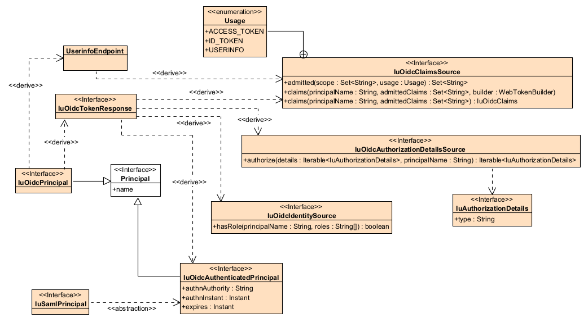
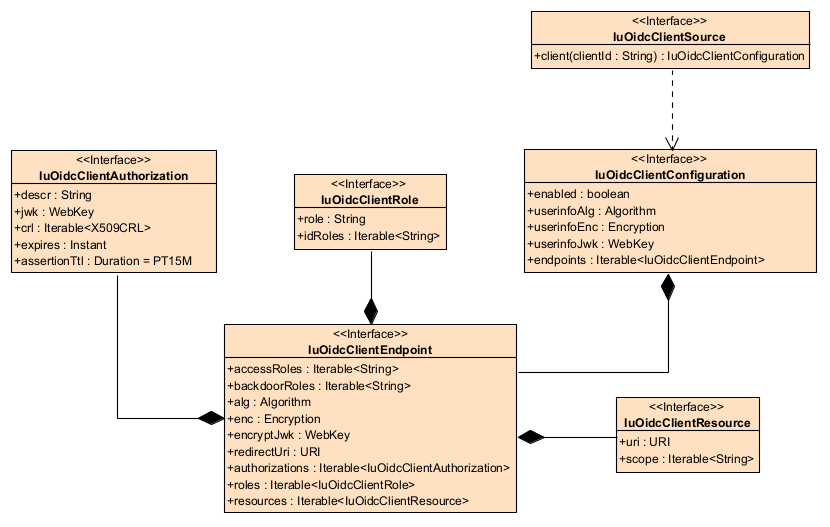

IU OpenID Connect and OAuth 2.0 Configuration
---------------------------------------------

Overview
========

`iu-java-oidc-config` (module `iu.util.oidc.config`, package `edu.iu.oidc.config`) is the OpenID Provider's integration layer: what a deployment configures, and the interfaces it implements over its own backing resources — a directory, a group service, a login mechanism. The provider endpoints in `iu.util.oidc.provider` consume these interfaces; an implementation of them must never depend on `iu.util.oidc.provider`.

Deriving `IuOidcPrincipal`
==========================

A «derive» arrow points from the derived element to what it is computed from. An application endpoint — the relying party — holds an `IuOidcPrincipal`, computed from the token response and the UserInfo response the provider issued. Both of those are computed from four seams the deployment implements: `IuOidcAuthenticatedPrincipal`, `IuOidcClaimsSource`, `IuOidcIdentitySource`, and `IuOidcAuthorizationDetailsSource`. `UserinfoEndpoint` is the protocol endpoint, served on this side by `iu.oidc.provider.OidcUserinfoEndpoint`. `IuSamlPrincipal` is one concrete form of the `IuOidcAuthenticatedPrincipal` abstraction; nothing in this module depends on SAML.

Implementing a provider
=======================

### Bind everything through one `IuOidcProviderReference`

Every provider endpoint takes a single `iu.oidc.provider.IuOidcProviderReference` and reads each seam through it, so two endpoints cannot be wired to disagree about who the provider is. The reference lives in `iu.util.oidc.provider` and is implemented by whatever stands the provider up; the seams it hands over live here, so their implementations need no provider dependency. Only `getConfiguration()` is abstract. Every other binding either refuses by name when it is needed and missing (`Missing claims source`) or defaults safely: `getAuthorizationDetailsSource()` releases nothing, and `isProduction()` answers `true`, which keeps impersonation through token exchange closed.

Relying party registrations are read through `IuOidcClientSource`, which is equally mandatory; see [Client registration](#client-registration).

### `IuOidcProviderConfiguration` — the provider itself

Returned from `IuOidcProviderReference.getConfiguration()`, and the one binding with no default. `getMetadata()` is the discovery document, published verbatim; its `issuer` is the base URI every one of the provider's own endpoints is built from, so advertising an issuer the deployment isn't reachable at breaks authentication, not just discovery. `getJwks()` are the provider's signing keys, in preference order: a key's `alg` selects it, the first signing key is used when no algorithm is called for, and the signature algorithms discovery advertises are derived from them. Three lifetimes default and may be overridden: `authorization_code_time_to_live` (one minute), `access_token_time_to_live` (fifteen minutes), and `refresh_token_time_to_live` (twelve hours, which should not outlast the authentication it descends from).

### `IuOidcAuthenticatedPrincipal` — who authenticated

Returned from `IuOidcProviderReference.getAuthenticatedPrincipal(IuRequestAttributes)`. Adapt whatever mechanism the deployment authenticates with; an `IuSamlPrincipal`, for example, supplies the first three properties one-to-one.

| Property | Becomes |
|---|---|
| `name` | the principal name every grant is issued for, and the `sub` of every token and UserInfo document |
| `authnAuthority` | the `acr` claim — typically the identity provider's entity ID |
| `authnInstant` | the `auth_time` claim, and the instant a refresh token's lifetime is measured from |
| `expires` | whether the authentication is still usable; `null` or past sends the end user back to log in |

Return `null` when nothing is established — the first pass of every authorization is unauthenticated, not a failure — or throw to interrupt the flow with a login redirect the provider does not handle itself.

### `IuOidcClaimsSource` — what is published about the end user

Disclosure is decided in two halves. The claim sets OpenID Connect §5.4 binds to `profile`, `email`, `address`, and `phone` are mapped by the provider; every other scope is the deployment's.

- `admitted(scope, usage)` names the claims the deployment's own scopes release. It only ever sees scopes §5.4 does not define. `Usage` says where the result is headed — `USERINFO` is the widest disclosure, `ID_TOKEN` narrower because the relying party keeps it, `ACCESS_TOKEN` narrower still — so a claim can be published from UserInfo and kept out of a durable token.
- `claims(principalName, admittedClaims, builder)` writes typed claims onto a token being issued, including a signed UserInfo response.
- `claims(principalName, admittedClaims)` answers the unsigned UserInfo document; its `toString()` must render the claims document, which the provider publishes without reading.

Write nothing beyond `admittedClaims`, and answer for exactly `principalName` — the relying party refuses a UserInfo response whose `sub` disagrees with its ID token. A scope of the deployment's own must also be registered on some `IuOidcClientResource.getScope()`, or the authorization request is refused as `invalid_scope` before this source is consulted.

### `IuOidcIdentitySource` — what the end user is entitled to

A client endpoint declares application roles as `IuOidcClientRole`, each naming the identity roles (`getIdRoles()`) that grant it. `hasRole(principalName, roles...)` decides which of those the principal holds, and the matching application roles (`getRole()`) are issued as the `roles` claim. A role of `all`, and a role naming the principal directly, are settled before the source is asked. Throw when the principal name cannot be resolved (answered as `invalid_request`); answer `false` when the principal is known and holds none of the roles.

### `IuOidcAuthorizationDetailsSource` — what RFC 9396 details are released

`authorize(details, principalName)` is called once per grant, after the end user authenticates and before an authorization code is issued. Return what is released, or `null` to release nothing. The exception thrown decides who hears about a refusal:

| Thrown | Answered as |
|---|---|
| `IuBadRequestException` | `invalid_authorization_details` on the client's redirect URI — the only refusal relayed to the client |
| `IuAuthorizationFailedException` | forbidden |
| `IuOutOfServiceException` | unavailable, so a caller can retry |
| anything else | server error |

The provider sees only `IuAuthorizationDetails.getType()`. A deployment whose details carry properties beyond the type registers a claim adapter for its own implementation.

### What the application endpoint sees

| `IuOidcPrincipal` | Read from | Supplied by |
|---|---|---|
| `getName()` | ID token `sub`, or a configured principal name claim | `IuOidcAuthenticatedPrincipal.name` |
| `getClaim(...)`, `getOidcClaims()` | ID token, then UserInfo | `IuOidcClaimsSource` |
| `getAcr()` | ID token `acr` | `IuOidcAuthenticatedPrincipal.authnAuthority` |
| `hasRole(...)` | ID token `roles`, limited to the roles the relying party configures | `IuOidcIdentitySource` |
| `hasScope(...)` | granted `scope` on the token response, or the requested scope if the response omits it | [client registration](#client-registration) |
| `getAuthorizationDetails(...)` | token response `authorization_details`, then the ID token | `IuOidcAuthorizationDetailsSource` |

Client registration
===================

`IuOidcClientSource.client(clientId)` reads one relying party's registration, whole. An `IuOidcClientConfiguration` describes the client as a whole — whether it is enabled and how its UserInfo response is signed and encrypted — and owns its endpoints, one per redirect URI. Each `IuOidcClientEndpoint` owns everything that varies by redirect URI: the authorization records that authenticate it, its roles, and its resources. An endpoint owns zero or more of each, and each belongs to exactly one endpoint; the other end of every composition is implicitly one.

### Implementing `IuOidcClientSource`

Answer `null`, or throw, for a client that isn't registered; the provider refuses both the same way, indistinguishably from a client that never existed. Every provider endpoint reads through the source on every request, so caching is the implementation's decision — but a failed lookup should not be cached, so a client registered a moment ago is found on the next request. A disabled client (`enabled` false) stays registered, and the authorization and token endpoints refuse it as though it weren't — no new code, token, or refresh. Access tokens already issued keep working until they expire: UserInfo, like any resource server, trusts a token this provider signed and does not re-check the registration. Disabling a client is therefore bounded by the access token lifetime (fifteen minutes by default), not immediate.

Assemble the registration the way the provider reads it. The provider reaches authorization records and roles only through an endpoint: `IuOidcClientEndpoint.getAuthorizations()` authenticates the client, and `IuOidcClientEndpoint.getRoles()` is the only role mapping it consults. The client configuration holds neither, so there is nothing to merge into an endpoint.

The UserInfo settings belong to the client rather than an endpoint, because a UserInfo request presents an access token that names the client and no redirect URI to select an endpoint by. `userinfoAlg` defaults to `null`, which answers an unsigned claims document; `userinfoEnc` defaults to `null`, which answers an unencrypted one; `userinfoJwk` is the key an encrypted response is addressed to, required when `userinfoEnc` is set and unread otherwise.

### Endpoint settings

Each endpoint is selected by the `redirect_uri` an authorization request repeats exactly, and carries the settings that follow from that choice.

- **Tokens.** `alg` signs, and `enc` with `encryptJwk` encrypts, the ID token issued to the endpoint.
- **Resources.** The requested `resource` selects among `getResources()`, and the scopes the matching entries declare are what the request may ask for. The entry with no `uri` is the one a request naming no resource matches.
- **Access.** `getAccessRoles()` names the identity roles that entitle an end user to a token from the endpoint at all. `null` or empty admits no one, and `ALL` admits anyone.
- **Impersonation.** `getBackdoorRoles()` names the identity roles that entitle the holder of an `actor_token` to request another principal's token by RFC 8693 token exchange. `null` or empty refuses everyone, `ALL` opens it to anyone, and a production deployment refuses every exchange before reading it.

### Lifecycle

Everything in a registration lives and dies with its parent: endpoints with their client, and authorization records, roles, and resources with their endpoint. A registration can therefore be read, written, and versioned as one document. Deleting an endpoint deletes what it owns, and nothing is shared between endpoints, so a change to one endpoint can never reach another.

**Authorization records** are owned by the endpoint that lists them.

- **Public and closed endpoints.** An endpoint with no record accepts nothing, not even a public request with no credential. A record that carries no key is what registers an endpoint as public.
- **Rotation.** An endpoint tries its records in order, and the first that accepts the presented credential wins. Rotate by adding the new record ahead of the old one on each endpoint that should honor it, and letting the old one reach `expires`. An expired record is skipped rather than refused, so rotation needs no change to the client itself.
- **Revocation.** Takes effect when the client's cached registration does. Revoking or expiring a record invalidates that one client's cache entry.
- **Key material.** A credential honored by several endpoints is a record on each of them. An implementation that wants to manage one key in one place keeps its own identity for it and expands it per endpoint when it assembles the registration.

**Roles** are owned by the endpoint that lists them, and the endpoint's effective set is exactly `getRoles()`.

- **No inheritance.** The client holds no roles, so a mapping common to several endpoints is repeated on each. An implementation that keeps client-wide mappings must expand them into every endpoint's `getRoles()`, since the provider reads nothing else.
- **Name collisions.** The provider issues every matching role, so two roles in one endpoint sharing a `role` name with different `idRoles` repeat the name in the `roles` claim. Reject duplicate names within an endpoint, or define which wins.
- **Scope of a change.** Editing a role changes one endpoint only.
